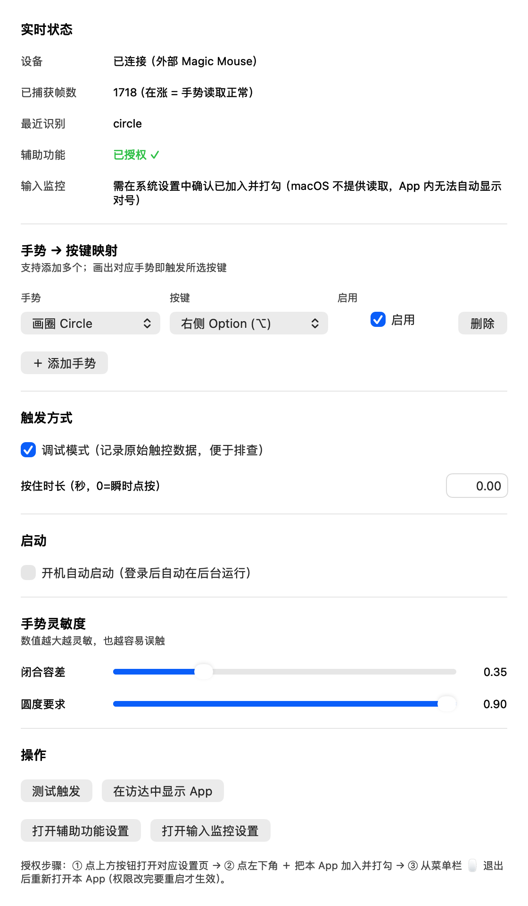

# GlyphKey · 指诀

> **在苹果鼠标上画一个手势，让它替你按一个键。**
> Draw a gesture on your Apple mouse — send a key.

[](LICENSE)

[](https://x.com/ph4ble)



**GlyphKey（指诀）** 是一个 macOS 菜单栏小工具：把你在 **Apple Magic Mouse / 触控板** 上画出的手势，映射成任意一个键盘按键。

默认：**在鼠标表面画一个圈 → 发送右侧 Option 键**（可用来一键开关微信语音输入）。你也可以在图形界面里自由添加多个「手势 → 按键」映射。

> English: **GlyphKey** is a tiny macOS menu-bar app that turns gestures drawn on an Apple mouse or trackpad into keyboard keys. Map any gesture (circle, swipe, tap…) to any key — with a live status panel, customizable sensitivity, and a one-click launch-at-login toggle.

---

## 🧭 缘起

我平时用**语音输入法**打字。可每次开始 / 停止语音，都得先按一下某个键，手又得离开鼠标去够键盘——**一会儿按键、一会儿挪鼠标**，来回切换很别扭，思路也被打断。

既然手本来就在鼠标上，那能不能**用鼠标画个手势，就把这个键给按了**？于是就有了 GlyphKey：**只用鼠标，就能完成「按键」这一步。**

默认我把「画一个圈」映射成「右侧 Option」，正好用来一键开关微信语音输入；你也可以按自己的习惯，改成任意手势 → 任意按键。

> 作者 / Author：[@ph4ble](https://x.com/ph4ble) · 欢迎交流与反馈。

---

## ✨ 特性

- 🖱️ **多种内置手势**：画圈、上/下/左/右滑、点按、双击。
- 🔑 **任意按键**：每个手势可映射到 Option / 空格 / 回车 / Control / Command / Shift（区分左右）。
- 🧩 **可增删的自定义映射**：设置里随时「＋ 添加手势 / 删除」，可同时启用多条。
- 🟢 **实时状态面板**：设备连接、已捕获帧数、最近识别、辅助功能授权状态一目了然。
- 🎚️ **灵敏度可调**：闭合容差、圆度要求两个滑块，自己权衡「易触发」与「防误触」。
- 🚀 **开机自动启动**：设置里一个开关（走系统登录项，或自动兜底 LaunchAgent）。
- 🔧 **一键测试**：「测试触发」按钮直接验证按键是否真的发出；内置打开系统权限页的入口。
- 🐞 **调试模式**：把每帧原始触控数据写入日志，便于排查。

---

## 🧠 原理

- 通过 macOS 私有框架 **`MultitouchSupport.framework`** 读取鼠标表面触控，运行时用 `dlopen` / `dlsym` 动态加载，不链接、不依赖头文件。
- 触控点坐标在结构体中的字节偏移随系统版本 / 设备而异：引擎**优先使用已确认的 `(32,36)` 归一化坐标偏移**，并对每个笔画做「有限范围 + 真实位移」校验，避免误用速度 / 时间戳等噪声字段。
- 笔画结束（抬指后约 0.25s）后，提取归一化轨迹并判定手势：
  - **画圈**：要求尺寸够大、长宽比接近 1，并且**朝同一方向净旋转**（净旋转 ≈ 累计角度）。这是借鉴 **$1 Unistroke Recognizer** 的方向一致性思想，能有效排除「轻点抖动」被误判成圈。
  - **滑动**：接近直线的位移。
  - **点按 / 双击**：短促、位移极小。
- 命中启用中的映射后，通过 **CoreGraphics** 发送一次键盘事件（对修饰键会带上「右侧」设备标志位，松开时清空，避免修饰键卡住）。
- 只连接**外部设备**（Magic Mouse）；内置触控板会被跳过，避免手掌误触污染笔画。

---

## 📦 系统要求

- 一台 Mac + **Apple Magic Mouse**（或支持多点触控的触控板）。
- macOS **11 (Big Sur)** 或更新（`SMAppService` 开机启动需 13+，低版本自动用 LaunchAgent 兜底）。
- 编译需要 **Xcode 命令行工具**：`xcode-select --install`。

---

## 🚀 快速开始

```sh
git clone <你的仓库地址> glyphkey
cd glyphkey
sh build.sh
```

构建产物：

- **图形界面版（推荐）**：`open GlyphKey.app`，或直接双击 `GlyphKey.app`。启动后设置窗口自动弹出，菜单栏出现 🖱️ 图标。
- **命令行版（调试用）**：`./GlyphKey`。

> 🍎 **从 Releases 下载的 App 首次打不开？** 本项目未做 Apple 公证（notarization），Gatekeeper 可能拦截。请**右键点 App → 打开**，或到「系统设置 → 隐私与安全性」底部点「仍要打开」。之后就能正常双击运行。

---

## 🔐 权限（最关键，没授权就「没反应」）

GlyphKey 需要**读取鼠标触控**并**向其他 App 发送按键**，macOS 会拦截，必须手动授权 **两项**：

1. **辅助功能**（Accessibility）—— 发送按键
2. **输入监控**（Input Monitoring）—— 读取触控

> ⚠️ 只「打开系统设置页面」是不够的：**必须点 ＋ 把本 App 加入列表并打勾**，而且**改完要退出 App 重新打开**才生效。

### 步骤（图形界面版）

1. 打开 GlyphKey 设置窗口，点 **「打开辅助功能设置」**。
2. 在「系统设置 → 隐私与安全性 → **辅助功能**」里点 **＋**，选中 `GlyphKey.app`，确认开关打开。
   - 找不到？先点设置里的 **「在访达中显示 App」**，把 App 拖进 ＋ 的文件框；或先把 `GlyphKey.app` 拖进 `/Applications`。
3. 同样地，在 **输入监控** 里把 `GlyphKey.app` 也加入并打勾。
4. **菜单栏 🖱️ → 退出**，再重新打开 `GlyphKey.app`。
5. 回到设置窗口看「实时状态」：辅助功能应显示 **已授权 ✓**，滑动手指时「已捕获帧数」会上涨。

> 命令行版（`./GlyphKey`）则把 **终端 Terminal** 加进上述两个列表。

> 📌 **为什么 App 里「输入监控」没有绿色对号？** macOS 不向 App 提供读取「输入监控」授权状态的接口（辅助功能有、输入监控没有），所以 App 无法自动显示对号——这**不代表没授权**。以「系统设置」里的勾为准，并看「已捕获帧数」是否在动。

### 关于重新编译后的授权

`build.sh` 会优先使用本机的 **稳定自签证书**（`MouseGestureKey Local Signing`）签名，这样**重新编译后授权不会失效**。若你的机器上没有这张证书，会退回 **ad-hoc 签名**——此时每编译一次签名就变一次，需要重新授权。想一劳永逸可自行创建一张本地代码签名证书（任意方式均可，只要 CN 与 `build.sh` 里的 `CERT` 一致）。

---

## 🧩 自定义手势

打开设置窗口 → **「手势 → 按键映射」**：

1. 每行是一条映射：左选**手势**，中选**要发送的按键**，右侧勾选**启用**。
2. 点 **「＋ 添加手势」** 新增；点 **「删除」** 移除。改完即时保存。
3. 支持的手势类型：

| 手势 | 说明 |
|------|------|
| `circle` 画圈 | 画一个闭环（要求够大、够圆、单向旋转） |
| `swipeLeft` / `swipeRight` | 向左 / 向右拖动 |
| `swipeUp` / `swipeDown` | 向上 / 向下拖动 |
| `tap` 点按 | 短促轻点 |
| `doubleTap` 双击 | 两次快速点按 |

> 当前「自定义」指**自由组合这些手势 → 任意按键**并增删映射；识别任意自绘形状（如三角形）属于后续路线图。

---

## ⚙️ 配置

配置自动保存在 **`~/.mousegesturekey.json`**（GUI 改动会写回该文件，也可手动编辑）。

```json
{
  "bindings": [
    { "gesture": "circle",     "keyCode": 61, "flag": "rightOption", "enabled": true  },
    { "gesture": "swipeRight", "keyCode": 49, "flag": "",           "enabled": false },
    { "gesture": "tap",        "keyCode": 55, "flag": "command",    "enabled": false }
  ],
  "debug": false,
  "holdSeconds": 0,
  "minAngularCoverage": 3.8,
  "maxRadiusStd": 0.9,
  "maxClosure": 0.35
}
```

| 字段 | 含义 |
|------|------|
| `bindings[].gesture` | 手势类型（见上表） |
| `bindings[].keyCode` | macOS 虚拟键码 |
| `bindings[].flag` | 修饰键家族：`rightOption` / `leftOption` / `rightControl` / `control` / `rightShift` / `shift` / `command` / `""` |
| `bindings[].enabled` | 是否启用 |
| `debug` | 调试模式（写原始触控帧到日志） |
| `holdSeconds` | 按住时长（秒）；`0`=瞬时点按，`>0`=按住再松开 |
| `minAngularCoverage` | 画圈至少扫过的角度（弧度），越大越不易误判 |
| `maxRadiusStd` | 半径波动容忍（标准差 / 均值），越大越宽松 |
| `maxClosure` | 路径闭合度（净位移 / 路径长）阈值，越大越宽松 |

### 按键预设

| 按键 | keyCode(hex) | keyCode(dec) | flag |
|------|--------------|--------------|------|
| 右侧 Option | 0x3D | 61 | `rightOption` |
| 左侧 Option | 0x3A | 58 | `leftOption` |
| 空格 Space | 0x31 | 49 | `""` |
| 回车 Return | 0x24 | 36 | `""` |
| 右侧 Control | 0x3E | 62 | `rightControl` |
| 左侧 Control | 0x3B | 59 | `control` |
| Command ⌘ | 0x37 | 55 | `command` |
| 右侧 Shift ⇧ | 0x3C | 60 | `rightShift` |

---

## 🚀 开机自动启动

设置窗口 → **「启动」** → 勾选 **「开机自动启动」** 即可：

- macOS 13+ 走系统 **`SMAppService`**，可在「系统设置 → 通用 → 登录项」中查看 / 管理。
- 若注册失败，自动退回 per-user **LaunchAgent**（`~/Library/LaunchAgents/com.user.mousegesturekey.plist`）。

命令行版也可用仓库里的 `launchagent.sample.plist` 模板手动配置。

---

## 🖥️ 命令行版 & 自测

```sh
./GlyphKey              # 运行（调试模式下可见 FIRED 日志）
./GlyphKey --selftest   # 内置自测：整圆 / 半弧 / 直线 / 抖动
```

自测会校验：整圆 → `circle`；半弧 → `nil`；直线 → 滑动；**抖动噪声 → 不误判为 circle**。

---

## 🩺 排查

1. 看设置窗口「实时状态」：设备是否已连接、辅助功能是否已授权、帧数是否在涨。
2. 勾选「调试模式」，用 `./GlyphKey` 运行，日志会打印每帧与判定：

   ```
   frame n=1 pts=12: 8:... 32:0.42 36:0.78 ...
   extract off=(32,36) w=0.430 h=0.216
   classify dur=1.23 w=0.43 h=0.22 sweep=6.23 net=6.21 std=0.41 ... => circle
   FIRED gesture=circle keyCode=61 flag=rightOption
   ```

   - **完全没有 `frame` 输出** → 权限不足，或设备未被识别为外部设备。
   - **有输出但不触发** → 看 `classify` 行的 `sweep / net / std` 与是否 `=> nil`；轻点误触就调大 `maxRadiusStd` 或尺寸门槛，漏触就调小。

---

## 🗺️ 路线图

- [ ] 任意自绘形状的手势识别（三角形、字母等）。
- [ ] 多点 / 组合手势。
- [ ] 触发「点击屏幕坐标」或「运行快捷指令」。
- [ ] 按键组合序列（如 ⌘+Shift+D）。

---

## 📄 许可证

MIT License，详见 [LICENSE](LICENSE)。欢迎 Issue 与 PR。

> 作者：[ph4ble](https://x.com/ph4ble) · X：https://x.com/ph4ble

---

## ⚠️ 局限

- 仅支持单指笔画的预设手势类型；复杂多点手势暂未实现。
- 依赖私有框架，极端情况下某个 macOS 大版本可能改接口（已用运行时加载 + 多偏移探测尽量降低风险）。
- 发送的是「物理按键」，需要辅助功能 + 输入监控两项权限。
